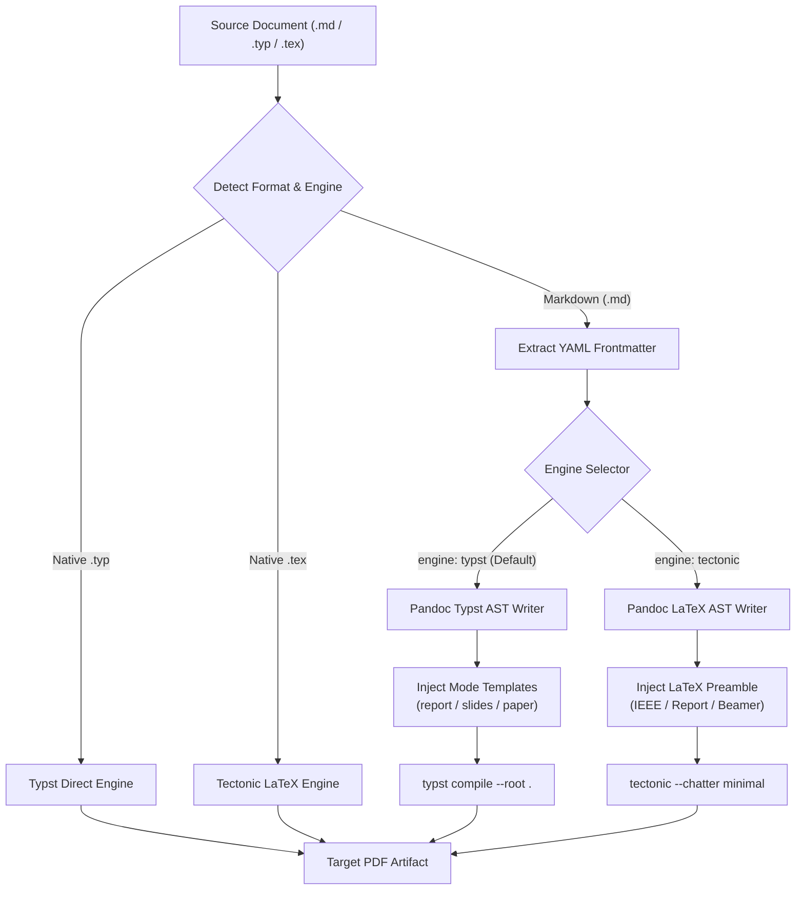
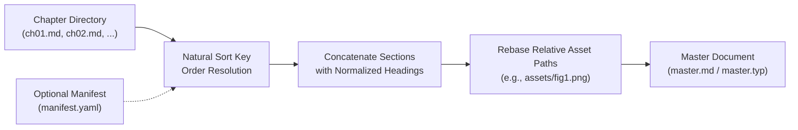

# Architecture & Compiler Pipeline

Snowpack operates as an orchestrated compiler frontend that unifies Markdown, Typst, and LaTeX into deterministic PDF artifacts. It abstracts away engine-specific invocation details, providing unified frontmatter parsing, asset path resolution, and live file synchronization.

---

## Compiler Pipeline

Snowpack analyzes incoming document formats, extracts metadata, routes the document to the appropriate compiler backend, and handles post-processing.



---

## Hermetic Execution Model

Traditional TeX and PDF generation stacks suffer from non-deterministic environments: missing CTAN packages, mismatched font configurations, and divergent engine versions across developer machines.

Snowpack addresses this through two layers:

1. **Flake Hermeticism**: When packaged in Nix, the exact binaries for `pandoc`, `typst`, and `tectonic` are locked to explicit cryptographic hashes. System-level LaTeX installations and global Python environments cannot pollute the build.
2. **Deterministic Root Scoping**: All path resolution for embedded figures, code listings, and bibliographies is anchored to a defined root directory (`--root PATH`, defaulting to the workspace root). Relative paths remain portable across local workstations, CI runners, and containerized builders.

---

## Polyglot AST and Frontmatter

Snowpack implements a YAML frontmatter parser that bridges high-level document metadata with low-level Typst and LaTeX show rules.

### Frontmatter Normalization

When compiling Markdown, Snowpack extracts the top YAML block and normalizes parameters across backends:

```markdown
---
title: "Autonomous Space Exploration Systems"
author: "Dr. Alex Rivera"
affiliation: "Robotics and Controls Laboratory"
date: "2026-10-15"
mode: "report"
theme: "dark"
---
```

The frontmatter dictionary is translated into template keyword arguments (`build_typst_kwargs`):
- `mode` is normalized into `report`, `slides`, or `paper`.
- `theme` controls slide deck presentation styling (e.g., slate dark `#0F172A` vs. clean paper light `#FFFFFF`).
- `aspect-ratio` dictates presentation dimensions (defaults to `16-9` / 1920×1080).
- `preset` controls academic formatting presets (e.g., `ieee` two-column layout).

---

## Chapter Assembler

For extensive technical manuscripts, course companions, and textbooks, keeping an entire book in a single monolithic `.md` or `.typ` file causes merge conflicts and unwieldy diffs.

Snowpack provides an integrated assembly subsystem (`snowpack assemble [dir]`):



1. **Natural Sorting**: File ordering respects human numerical conventions (`ch1.md`, `ch2.md`, ..., `ch10.md` rather than standard alphabetical sorting where `ch10.md` precedes `ch2.md`).
2. **Path Rebasing**: Embedded image paths and code snippet includes within subdirectories are automatically rebased relative to the master document destination.
3. **Manifest Governance**: If a `manifest.yaml` or `manifest.json` exists, explicit chapter inclusions, exclusions, and order take precedence over directory scanning.

---

## Live Watch Daemon

Snowpack features an in-process filesystem watcher (`snowpack.watcher.watch_pdf`) optimized for sub-second edit cycles.

1. **Debounced Recompilation**: Prevents rapid successive compiles when editors write lockfiles or multi-part saves.
2. **Process Death Signals (`PR_SET_PDEATHSIG`)**: On Linux systems, compilation subprocesses receive `SIGTERM` if the parent watcher terminates, preventing orphaned background compiler tasks.
3. **Sub-second Feedback**: Typst recompilation typically completes in 30ms–120ms, allowing instantaneous updates in external PDF viewers with live autoreload support (such as Sioyek, Zathura, or Evince).
